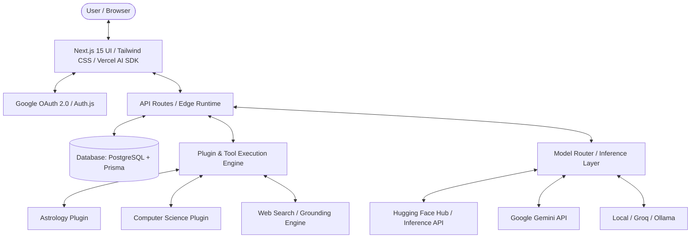

# MIRA - Next-Generation AI Assistant & Modular Plugin Platform

MIRA is a ChatGPT and Gemini-grade conversational AI platform with real-time web retrieval, plug-and-play domain plugins (Astrology, Computer Science, and more), Google OAuth authentication, persistent chat history, and multi-model inference (Hugging Face, Gemini, Open-source LLMs).

---

## 🌟 Key Features

- **ChatGPT / Gemini Style UI**: Fluid streaming text responses, markdown & LaTeX rendering, code syntax highlighting with copy-to-clipboard, sidebar for conversation management.
- **Live Internet Access & Grounding**: Web search engine integration (Tavily / DuckDuckGo / SearXNG) enabling MIRA to access up-to-the-minute real-world knowledge.
- **Modular Plugin Ecosystem**:
  - 🔮 **Astrology Plugin**: Natal birth chart calculation, planetary transit analysis, daily horoscope generation, and astrological reasoning.
  - 💻 **Computer Science Plugin**: Code analysis, live execution sandbox, algorithm visualization, and technical documentation lookup.
  - 🌐 **Web Search / Deep Research Plugin**: Real-time multi-source factual search with inline citations.
- **Authentication**: Seamless Google OAuth 2.0 login/logout with protected sessions.
- **Persistent Chat History**: PostgreSQL (or SQLite/MongoDB) with Prisma/Drizzle ORM for thread branching, renaming, and persistent user histories.
- **Model Flexibility**: Hugging Face Inference API / Endpoints (Llama 3.3, Qwen 2.5, DeepSeek, Mistral) alongside Google Gemini & OpenAI.

---

## 🏛️ System Architecture

---

## 🚀 Roadmap & Setup

Detailed documentation and step-by-step implementation guide are outlined in the project design artifact.
